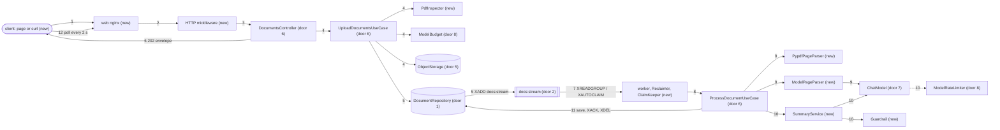
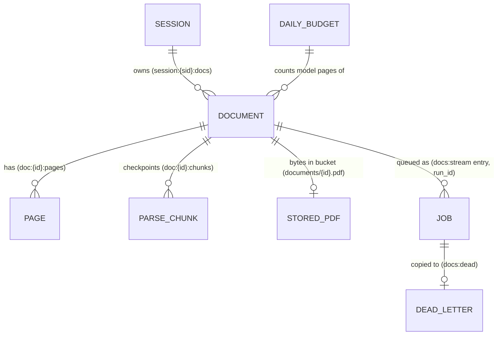
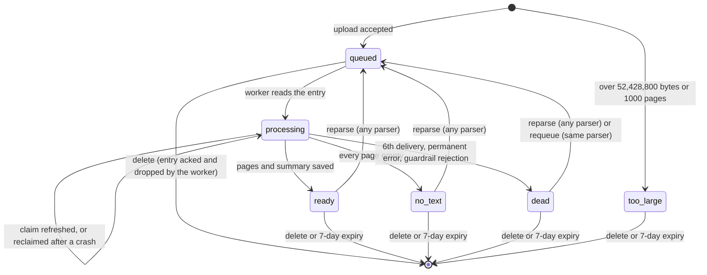

# Document processing - upload PDFs, parse per page, summarize, async on Redis Streams

**Approved**: 2026-11-19 - user: "Approve the plan"
**Settled mid-build:** 2026-11-19 (design session, before any build) - user: "use instagram as the base layout but with other colors choose which combine more here purple or green as the primary and do it with light and dark mode options"; then chose fonts "Keep both", stories row "Yes, progress rings", desktop "Instagram 3 columns", prototype "Live HTML mockup" - AD-020; criteria 67-71 and `GET /api/v1/budget` added; then "we must have a chip clickable filter that is default just already parsed docs, and will have the other option to show all parsed queued and processing, on stories they will never be ommited, this filter is only for the feed aread" - AD-021, criteria 16 and 72, `state` on `GET /api/v1/documents`; then "how about the failed ones? we must have one option to retry and see the failed, retry or remove forever" - AD-022, criteria 16, 72 and 73 rewritten: Parsed / Failed / All chips, Retry and Delete forever on failed cards; canvas frames PhoneFailed and PhoneDelete approved: "Looks right"; then, answering the build's stops: "1- you have my ok" (S6 frame captures and the sample downloads; the two public samples were downloaded the same day into `samples/`), "2- if the decision is easy to decide what is better you take, just if is a metter of preference, but most part try to do at your own" - AD-023, "4- really? if you can you can push, if is not allowed you can just commit and we push in the end" - AD-023 (push to `origin/main` after each slice commit is approved), "6: perfect, if possible use as well playwright cli to test all and guarantee we have no issues." - AD-024, criterion 81; the two loose text labels on the DesktopDark frame are notes, not UI - AD-025
**Review:** 2026-11-20 - Verifier and screens round 1 sent at `19cf1ff` (fresh sub-agents); Verifier FAIL with 9 findings, screens 5 match and 6 diverge; after the pre-push review, Verifier on 4aa581f..68cfd98 and a new screens review (AD-049, round 1 at `932cbba`: 10 match, DesktopUpload diverges on the padlock) sent as fresh sub-agents
**Fix pass:** 2026-11-20 - `28a6e1c` closes all 9 findings and the 6 diverging frames (AD-039, AD-040, AD-041); pictures re-saved and screens round 2 sent at `28a6e1c`; `8335551` closes the open pre-push items and the PhonePages frame (AD-042..AD-047), `68cfd98` the DesktopUpload padlock, `9de7ed3` the Verifier's 3 findings on 4aa581f..68cfd98; pictures re-saved and the new review's round 2 sent at `68cfd98`

## Problem

A reviewer at the hiring company has to judge, from a zip and a README, whether the candidate can
ship an AI-driven backend that holds up under load. Today there is no application: no upload, no
parser, no queue, no summary, no page. The brief (`docs/private/BWAI2.1_test_task.docx`, local
and gitignored, verbatim in `docs/private/test-task.md`) ranks what it wants to see: a backend that serves concurrent requests, PyPDF
parsing, a Redis Streams queue, a Gemini summary, GPT-5 Mini OCR, then a frontend. It also hides
traps a careless build falls into: "accepts any PDF" (encrypted, scanned, corrupt, huge), a free
tier that rate-limits (429), a model id written with a stray space and mismatched quotes
(`" gemini-3.1-flash-lite ”`), a parser list that names two methods in one place and three in
another, and no word on who may read whose documents. Three public versions of this same task were
found (`kliuchnikovv/summer`, `masalinas/bwaai2`, `Ralfidze/doc-pipeline`, all 0 stars). Their
gaps are the bar to beat: no GPT-5 Mini at all (2 of 3), published demo credentials, a 25-page
Gemini cap, no Redis persistence, flat scaling with no evidence, a 503 after a Redis restart.

When this ships, a reviewer runs one `docker compose up`, uploads one or more PDFs from a phone or a
laptop (or curl), picks `pypdf`, `gemini-3.1-flash-lite` or `gpt-5-mini`, and within seconds sees
per-page content and one summary per file. They can then read in `evidence/` and the README how it
survives concurrent load, a killed worker, a rate limit and a hostile PDF, and how it was built
with AI.

## Shape

Greenfield: nothing exists to reuse; the backend follows one pattern everywhere - a thin
controller calls one use case, the use case composes small services, and every outside system
(Redis, S3, OpenRouter, pypdf) sits behind an interface file that lives beside its implementations
(AD-011). Every rule that changes an outcome - validation, limits, state transitions, retry
classification, budget, chunking, ownership, ordering of the feed - runs in `app/documents/domain`,
`app/documents/use_cases` and `app/documents/services`, which pytest reaches with in-memory fakes
and, in integration tests, a real Redis and SeaweedFS in Compose with OpenRouter mocked (respx).

1. client -> `web` (new, nginx serving the built page, proxies `/api` to `api`) - same origin, so
   the session cookie is first-party
2. `HTTP middleware` (new) - request id, body-size cap, security headers (door 9), CORS for
   `PAGE_ORIGIN`, session JWT check (door 4), upload rate limits (door 8)
3. `DocumentsController` (door 6) - parses multipart, calls `UploadDocumentsUseCase`, wraps the
   result in the response envelope (door 3)
4. `UploadDocumentsUseCase` (door 6) - per file: `PdfInspector` (new, one-shot child process killed at 10 s, AD-026)
   checks magic bytes, size, encryption/password, page count; `ModelBudget` (door 8) reserves
   pages for model parsers; accepted bytes go to `ObjectStorage` -> SeaweedFS
   `documents/{id}.pdf` (door 5)
5. `DocumentRepository` (door 1) - one Lua script writes the record, the session index entry and
   the stream entry atomically: `doc:{id}` + `session:{sid}:docs` + `XADD docs:stream` (door 2)
6. out: `202` envelope with `documents[]` (`queued` or `too_large`) and `rejected[]`
7. `worker` (new, N replicas, consumer group `parsers`) - `XREADGROUP`; `Reclaimer` (new)
   `XAUTOCLAIM`s entries idle >= 60 s; `ClaimKeeper` (new) refreshes the claim of the running job
   every 20 s
8. `ProcessDocumentUseCase` (door 6) - skips stale or already-final runs (ack only); else marks
   `processing`, loads the PDF from `ObjectStorage`, picks a `PageParser` (door 7) by parser kind
9. `PypdfPageParser` (new) or `ModelPageParser` (new) - pypdf extracts text per page in a child
   process; the model parser splits the PDF into 10-page chunks and sends each to OpenRouter
   through `ChatModel` (new), checkpointing each chunk in `doc:{id}:chunks`
10. `SummaryService` (new) - `Guardrail` (new, Llama Guard 4) checks the input, `ChatModel` asks
    `google/gemini-3.1-flash-lite` for the summary (map-reduce over 300,000-character chunks),
    `Guardrail` checks the output; every OpenRouter call passes `ModelRateLimiter` (door 8) and
    `RetryPolicy` (new, 429/5xx/timeout backoff)
11. `DocumentRepository` (door 1) - saves pages + summary + final status (`ready`, `no_text`,
    `dead`), then `XACK` + `XDEL`; a dead job is copied to `docs:dead`
12. out: the page polls `GET /api/v1/documents` every 2 s while any document is `queued` or
    `processing`, and reads pages from `GET /api/v1/documents/{id}/pages`



**Backend layout (AD-011, door 6).** Feature folder plus capability folders, interface file beside
its implementations; `import-linter` contracts keep `domain` free of every other `app` package and
keep `use_cases`/`services` off concrete adapters:

```
backend/app/
  main.py                    FastAPI app factory (lifespan opens Redis, S3, HTTP pools)
  serve.py                   API entry point: validates settings, names a bad variable, runs uvicorn
  container.py               composition root of the API: builds every adapter, injects it
  worker_container.py        composition root of a worker
  infrastructure.py          opens the Redis, S3 and HTTP clients
  core/                      settings.py, envelope.py, errors.py, logging.py, clock.py, ids.py,
                             request_context.py, health.py, isolated.py (one-shot child, AD-026)
  security/                  session_token.py, session_guard.py, headers.py, cors.py,
                             body_limit.py, request_id.py, error_boundary.py, asgi_types.py
  rate_limit/                rate_limiter.py (interface), redis_sliding_window.py (window +
                             in-flight counter), model_budget.py (interface),
                             redis_model_budget.py, lua/
  documents/
    domain/                  document.py, document_status.py, parser_kind.py, page.py,
                             rejection.py, errors.py, job_errors.py, transitions.py
    use_cases/               upload_documents.py, read_documents.py (list, get, pages, budget),
                             rerun_documents.py (reparse, requeue), delete_document.py,
                             ownership.py, process_document.py
    services/                pdf_inspector.py, pdf_validation.py, filename.py,
                             parser_selector.py, summary_service.py, text_chunker.py,
                             prompt_builder.py
    controllers/             documents_controller.py, upload_controller.py,
                             sessions_controller.py, budget_controller.py,
                             health_controller.py, error_handlers.py, api_services.py,
                             session_dependency.py, responses.py, schemas/ (DTOs, query params)
  parsers/                   page_parser.py (interface), pypdf_page_parser.py,
                             model_page_parser.py, pdf_tools.py (inspect, extract, split),
                             page_schema.py
  models/                    chat_model.py (interface), openrouter_chat_model.py,
                             retry_policy.py, call_gate.py, guardrail.py (interface),
                             llama_guard.py
  repositories/              document_repository.py (interface), redis_document_repository.py,
                             redis_feed_reader.py, feed_cursor.py, document_codec.py,
                             redis_keys.py, lua_scripts.py, lua/ (create, begin_run,
                             save_chunk, finalize, restart_run, delete)
  queue/                     job_queue.py (interface), redis_stream_queue.py, job.py
  storage/                   object_storage.py (interface), s3_object_storage.py
  worker/                    main.py, consumer_loop.py (read + reclaim sweep), claim_keeper.py,
                             heartbeat.py, shutdown.py
```

Every module holds one responsibility and stays at or under 200 lines (a test enforces it);
every public class and public method carries a docstring saying what it does and why (ruff `D1`
rules on `app/`); blank lines separate the steps inside a method (AD-017).

**Frontend layout (AD-018, door 10).** Page -> components -> nested components; each component
folder owns its children and its own `constants.ts`, `types.ts`, `utils.ts`, `hooks/` when it has
them; anything used in two places moves to `shared/`:

```
frontend/src/
  main.tsx, App.tsx           providers (QueryClient), the one page, no router
  pages/UploadPage/
    UploadPage.tsx, index.ts
    components/
      UploadForm/             UploadForm.tsx, constants.ts (MAX_FILES = 20), types.ts,
                              components/ ParserSelect/, FileDropZone/, SelectedFileList/
      DocumentFeed/           DocumentFeed.tsx, hooks/useDocumentsPolling.ts,
                              components/ DocumentCard/ (components/ SummaryBlock/, PageList/,
                              DocumentActions/, PasswordPrompt/), EmptyFeed/
  shared/
    api/                      client.ts (fetch + envelope unwrap), documents.ts, sessions.ts,
                              types.ts (DTOs mirroring the backend envelope)
    components/               Button/, Dialog/ (ConfirmDialog), Select/, StatusBadge/,
                              Markdown/ (no raw HTML), InlineError/, Spinner/
    constants/                parsers.ts, statuses.ts (`as const` objects, no TS `enum`)
    hooks/, utils/, styles/   tokens.css (colors, type, spacing)
```

**Changes underneath**

| Front | What changes |
| --- | --- |
| domain | nothing - greenfield, no existing term changes meaning |
| stored data | nothing to migrate - no data exists; Redis and the bucket start empty |
| readers | none outside this feature; the page and curl/Postman are the only readers |



New: every entity above - `SESSION` (JWT only, not stored), `DOCUMENT`, `PAGE`, `PARSE_CHUNK`,
`STORED_PDF`, `JOB`, `DEAD_LETTER`, `DAILY_BUDGET`. One-way constraints: one unacknowledged `JOB`
per `DOCUMENT`, enforced by the `run_id` compare-and-set in `begin_run.lua` and `restart_run.lua` (door 1, AD-005);
every `DOCUMENT` key and `STORED_PDF` expires after 604,800 s (AD-012).



## Surface

Every JSON body is the envelope `{"data": <object|array|null>, "error": <null|{"code","message","details"}>, "meta": {"request_id", ...}}`
(door 3). Pagination goes in `meta` (`next_cursor`, `total`, `offset`, `limit`). Every response
carries `X-Request-ID`. A document of another session answers `404 document_not_found`, never 403,
so ids do not leak.

| Route | In | Out | Status | Who |
| --- | --- | --- | --- | --- |
| `POST /api/v1/sessions` | nothing (cookie `pp_session` if present) | `data: {session_id, expires_at, token}` + `Set-Cookie: pp_session` | `201` new, `200` existing valid session, `429 rate_limited` | anyone (20 per 60 s per IP) |
| `POST /api/v1/documents` | multipart `files` (1-20), `parser`, optional `password` | `data: {documents: [Document], rejected: [{filename, code, message}]}` | `202` at least one stored, `422 invalid_parser` / `no_files` / `too_many_files` / `all_files_rejected`, `413 request_too_large`, `429 rate_limited` / `too_many_uploads_in_progress`, `401 session_required` | a session; others `401` |
| `GET /api/v1/documents` | `state` (`parsed` / `failed` / `active` / `all`, default `all`), `cursor`, `limit` (1-50, default 20) | `data: [Document]`, `meta.next_cursor` | `200`, `422 invalid_limit` / `invalid_cursor` / `invalid_state`, `401 session_required` | a session, own documents only; others `401` |
| `GET /api/v1/documents/{id}` | path id | `data: Document` (`summary` set only when `ready`) | `200`, `404 document_not_found`, `401 session_required` | owner; others `404`, no session `401` |
| `GET /api/v1/documents/{id}/pages` | `offset` (default 0), `limit` (1-100, default 50) | `data: [{number, content, format}]`, `meta.total` | `200`, `409 not_ready`, `404 document_not_found`, `422 invalid_limit`, `401 session_required` | owner; others `404`, no session `401` |
| `POST /api/v1/documents/{id}/reparse` | JSON `{parser}` | `data: Document` (`queued`) | `202`, `409 document_busy` / `not_reparsable`, `422 invalid_parser`, `429 model_budget_exhausted`, `404`, `401` | owner; others `404`, no session `401` |
| `POST /api/v1/documents/{id}/requeue` | nothing | `data: Document` (`queued`) | `202`, `409 document_busy` / `not_dead`, `404`, `401` | owner; others `404`, no session `401` |
| `DELETE /api/v1/documents/{id}` | nothing | `data: {id, deleted: true}` | `200`, `409 document_busy`, `404`, `401` | owner; others `404`, no session `401` |
| `GET /api/v1/budget` | nothing | `data: {used, limit, resets_at}` (UTC day) | `200`, `401 session_required` | a session; others `401` |
| `GET /api/v1/health/live` | nothing | `data: {status: "ok"}` | `200` | anyone |
| `GET /api/v1/health/ready` | nothing | `data: {status, checks: {redis, storage, openrouter}}` | `200`, `503 not_ready` | anyone |

`Document` = `{id, filename, parser, status, error_code, hint, page_count, size_bytes, created_at, updated_at, summary}`.

## Landing

| One-way door | Literal shape | Alternative rejected |
| --- | --- | --- |
| 1. Redis key schema | `doc:{id}` hash (record, `run_id`, `deliveries`); `doc:{id}:pages` list of JSON `{number, content, format}`; `doc:{id}:chunks` hash `chunk_index -> JSON pages`; `session:{sid}:docs` zset scored by `created_at` ms; all `EXPIRE 604800`; transitions only through `lua/create.lua`, `lua/transition.lua`, `lua/finalize.lua` | one JSON blob per document: every poll would move megabytes of pages, and a status change would rewrite them |
| 2. Queue contract | stream `docs:stream`, group `parsers`, consumer `{hostname}-{pid}`, entry `{document_id, object_key, run_id}`; dead letters `docs:dead` `{document_id, run_id, error_code, deliveries}`; `XACK` + `XDEL` after the final save; Redis `appendonly yes`, `appendfsync everysec`, `maxmemory-policy noeviction` | `XADD MAXLEN ~` trimming: it deletes pending, unacknowledged entries; a list + `BRPOPLPUSH`: the brief requires Streams |
| 3. API contract | prefix `/api/v1`; envelope `{data, error, meta}` on every JSON body including errors and health; error codes are snake_case literals listed in `Surface` | bare resources with RFC 9457 problem+json errors: a standard, but the user asked for one shape for success and failure alike; Stripe-style bare objects: two shapes for the client to branch on |
| 4. Session token | cookie `pp_session`, JWT HS256, claims `sub` (uuid4), `iat`, `exp` = 7 days, `HttpOnly`, `SameSite=Lax`, `Secure` when `COOKIE_SECURE=true`; also accepted as `Authorization: Bearer` for curl; `SESSION_SECRET` >= 32 bytes or the app refuses to start | a login with demo credentials: a screen between the reviewer and the feature, and published passwords (seen in `kliuchnikovv/summer`); an unsigned client id header: anyone could read another session's documents |
| 5. Object storage | S3 API via `aiobotocore`, bucket `S3_BUCKET` (default `documents`), key `documents/{id}.pdf`, lifecycle expiry 7 days; SeaweedFS (`chrislusf/seaweedfs`, `weed server -s3`) locally | MinIO: community edition archived Feb 2026 and its Docker Hub image deleted; PDF bytes in Redis: up to 20 x 50 MiB per upload in RAM |
| 6. Backend package pattern | `controllers -> use_cases -> services -> interfaces`, interface file beside implementations, wiring only in `container.py`, `import-linter` contracts in `backend/pyproject.toml` | classic top-level `domain/application/infrastructure/presentation`: interfaces far from implementations (user chose feature + ports beside adapters); a DI framework: hides the wiring a reader should see |
| 7. Model access | `httpx.AsyncClient` to `https://openrouter.ai/api/v1/chat/completions`; PDF sent as a `file` part (base64 data URL) with plugin `{"id": "file-parser", "pdf": {"engine": "native"}}`; JSON-schema structured output for pages; model ids `google/gemini-3.1-flash-lite`, `openai/gpt-5-mini`, guardrail `meta-llama/llama-guard-4-12b` | LangChain: none of the public versions of this task use it, it adds a large dependency tree for four kinds of calls, and its retry layer would hide the 429/`Retry-After` handling the brief tests; the `openai` SDK: its built-in retries fight `RetryPolicy`; `mistral-ocr` engine: $2 per 1,000 pages on a $5 key |
| 8. Limits | Redis sliding window (Lua on a zset) `ratelimit:upload:{sid}` 10 per 60 s, `ratelimit:session:{ip}` 20 per 60 s, `ratelimit:openrouter` 30 per 60 s shared; in-flight counter `inflight:upload:{sid}` max 2 (TTL 120 s safety); `budget:model_pages:{YYYY-MM-DD}` counter, cap `MODEL_PAGE_BUDGET_PER_DAY=3000`, TTL 172,800 s | in-process limits: they do not hold across 2 API processes and N workers |
| 9. Security headers | `secure` 2.x `SecureASGIMiddleware` with `Preset.BASIC`; CORS allow-list = `PAGE_ORIGIN` only, `allow_credentials=true` | hand-written headers: drift and gaps; `*` origin: forbidden by AD-006 and incompatible with credentials |
| 10. Frontend stack and pattern | React 19 + Vite + TypeScript strict, `@tanstack/react-query`, `react-hook-form`, `react-markdown` without `rehype-raw`; folders `pages/<Page>/components/<Component>/components/...` + `shared/`; `as const` objects instead of TS `enum` | Next.js: SSR adds a server the brief does not need for one page; a flat `components/` folder: the user asked for owned, nested children |
| 11. New dependencies | backend: `fastapi`, `uvicorn[standard]`, `redis>=5` (asyncio), `pydantic-settings`, `pypdf[crypto]`, `aiobotocore` + `types-aiobotocore[s3]`, `httpx`, `PyJWT`, `secure`, `structlog`, `python-multipart`; dev: `pytest`, `pytest-asyncio`, `pytest-cov`, `respx`, `asgi-lifespan`, `import-linter`, `ruff`, `mypy`; images `python:3.13-slim`, `redis:7.4-alpine`, `chrislusf/seaweedfs`, `nginx:alpine`, `node:22-alpine` (build) | `celery`/`arq`/`taskiq`: they would replace the Redis Streams consumer the brief asks to see |

| 12. Feed group index (door 1 additive, AD-029) | per session, besides `session:{sid}:docs`, one zset per feed group: `session:{sid}:docs:parsed`, `:failed`, `:active`, scored by `created_at` ms, `EXPIRE 604800`; moved only by the scripts that change the status; status changes go through `lua/create.lua`, `begin_run.lua`, `save_chunk.lua`, `finalize.lua`, `restart_run.lua`, `delete.lua` | filter by status on read: every 2 s poll would load every document of the session |
| 13. `fonttools` (door 11 additive, AD-031) | backend dependency `fonttools>=4.55` | none: pypdf needs it to read CFF font encodings |

- Nothing else in this change is hard to reverse

## Criteria

### S1: Upload with PyPDF through the Redis Streams queue, served concurrently (P1)

A reviewer runs `docker compose up`, creates a session with curl, uploads PDFs with `pypdf`, and
reads per-page text back while the API stays responsive under load.

**Acceptance Criteria**

1. WHEN `docker compose up` runs on a clean checkout THEN the system SHALL bring, with `.env`
   copied from `.env.example` and `SESSION_SECRET` set, `redis`, `storage`, `api`, `worker` and `web` to
   `healthy`, with `api` and `worker` declaring `depends_on: condition: service_healthy` on `redis`
   and `storage`
2. IF `SESSION_SECRET` is missing or shorter than 32 bytes THEN `api` SHALL exit at start with a
   message naming `SESSION_SECRET`
   - unset → exits; 31 bytes → exits; 32 bytes → starts
3. WHEN a client calls `POST /api/v1/sessions` without a valid session THEN the system SHALL return
   `201`, a `pp_session` cookie that is `HttpOnly`, `SameSite=Lax` and expires in 604,800 s, and
   `data.session_id`; WHEN it calls again with that cookie THEN it SHALL return `200` and the same
   `session_id`
4. IF a request to any `/api/v1/documents` route carries no valid session THEN the system SHALL
   return `401 session_required`
   - no cookie → 401; signature tampered → 401; `alg: none` → 401; expired 1 s ago → 401; valid
     `Authorization: Bearer` → accepted
5. WHEN a session uploads 1 to 20 valid PDFs with `parser=pypdf` THEN the system SHALL return `202`
   with one `data.documents[]` item per file in upload order, each `status: "queued"`, store each
   file at `documents/{id}.pdf`, and add exactly one `docs:stream` entry per file carrying only
   `document_id`, `object_key` and `run_id`
6. IF `parser` is not one of the 3 values THEN the system SHALL return `422 invalid_parser` with the three allowed values in
   `error.details.allowed` and store nothing
   - omitted → 422; `""` → 422; `"PyPDF"` → 422; `"gpt5mini"` → 422; `"pypdf"` → 202
7. IF an upload has 0 files THEN the system SHALL return `422 no_files`; IF it has more than 20
   THEN `422 too_many_files` and store nothing
   - 0 → 422; 20 → 202; 21 → 422 and 0 objects in the bucket
8. IF a file is not a readable PDF THEN the system SHALL list it in `data.rejected[]` with `not_pdf` (no `%PDF-` in its
   first 1,024 bytes), `empty` (0 bytes) or `unreadable_pdf` (pypdf cannot open it within 10 s),
   store nothing for it, and still accept the other files of the same upload
   - a PNG named `scan.pdf` → `not_pdf`; a PDF named `report.txt` → accepted; 1 bad + 2 good →
     202 with 2 documents and 1 rejected; 3 bad → `422 all_files_rejected` with 3 rejected
9. IF a file is larger than 52,428,800 bytes or has more than 1000 pages THEN the system SHALL save
   its record with `status: "too_large"`, store no object and add no stream entry
   - 52,428,800 bytes → queued; 52,428,801 → `too_large`; 1000 pages → queued; 1001 → `too_large`
10. IF an upload request body passes 1,074,790,400 bytes THEN the system SHALL stop reading and
    return `413 request_too_large` (20 x 50 MiB + 1 MiB, counted while streaming, whatever
    `Content-Length` claims)
11. WHEN a worker takes a `pypdf` job THEN the system SHALL set `processing`, extract one text string
    per page in a child process, and `GET /api/v1/documents/{id}/pages` SHALL return them as
    `{number, content, format: "text"}` in page order once the document is `ready`
12. IF every page has zero non-whitespace characters THEN the system SHALL set `status: "no_text"`
    with `hint` naming `gemini-3.1-flash-lite`
    - 3 blank pages → `no_text`; 1 character on page 2 of 3 → not `no_text`
13. WHILE a document is `queued`, `processing`, `no_text`, `too_large` or `dead` the system SHALL
    return `summary: null` and answer its pages route with `409 not_ready`
14. IF a session touches another session's document THEN the system SHALL return
    `404 document_not_found` for read, pages, reparse, requeue and delete, the same as for an id that does not exist
15. WHEN a session calls `GET /api/v1/documents` THEN the system SHALL return only its own
    documents, newest first, 20 by default, at most 50, with `meta.next_cursor` until the last page
    - 45 documents, `limit=20` → 20 + 20 + 5 and no cursor on the third; `limit=0`, `51` or `abc`
      → `422 invalid_limit`
16. WHEN a session calls `GET /api/v1/documents` with `state` THEN the system SHALL return
    only its documents in that group: `parsed` = `ready`, `no_text`; `failed` = `dead`,
    `too_large`; `active` = `queued`, `processing`; `all`, the default when `state` is omitted, =
    every status
    - 1 queued + 2 ready + 1 dead: `state=parsed` → the 2 ready; `state=failed` → the dead one;
      `state=active` → the queued one; omitted → all 4; `state=` or `state=final` →
      `422 invalid_state`
17. IF one session sends an 11th upload request within 60 s THEN the system SHALL return
    `429 rate_limited` with `Retry-After` in whole seconds; IF it has 2 upload requests in flight
    THEN a 3rd SHALL get `429 too_many_uploads_in_progress`; IF one IP creates a 21st session within
    60 s THEN `POST /api/v1/sessions` SHALL return `429 rate_limited`
18. WHEN a request carries `Origin` equal to `PAGE_ORIGIN` THEN the system SHALL echo it in
    `Access-Control-Allow-Origin` with credentials allowed; IF the origin differs THEN it SHALL send
    no `Access-Control-Allow-Origin`; it SHALL never send `*`
19. The system SHALL send the headers of `secure` `Preset.BASIC` on every response, asserted header
    by header on a `200`, a `404`, a `422` and a `500`
20. The system SHALL answer every JSON request with the envelope `{data, error, meta}` and an
    `X-Request-ID` header; IF a handler raises an unexpected exception THEN it SHALL return
    `500 internal_error` with no stack trace or exception text in the body
21. WHEN `GET /api/v1/health/ready` runs THEN the system SHALL return `200` when Redis answers
    `PING` and the bucket exists, and `503 not_ready` naming each failing check otherwise;
    `GET /api/v1/health/live` SHALL return `200` while the process runs
22. WHILE 3 workers run, WHEN load arrives THEN the system SHALL answer 5,000
    `GET /api/v1/documents` requests at concurrency 200 all with `200`
    (`docker compose up --scale worker=3`), and WHEN 50
    sessions upload one PDF each at the same moment THEN all 50 SHALL get `202` and reach `ready`
    with each document parsed exactly once (`deliveries: 1`); the load tool output SHALL be saved
    under `evidence/concurrency/`
23. The API SHALL never parse page content inside a request: the upload returns `202` with
    `status: "queued"` before any worker reads the entry, and PDF inspection runs in a process pool
    so the event loop keeps answering `GET /api/v1/health/live` during a 1000-page upload
24. WHEN the `redis` container restarts with 5 documents `queued` THEN the system SHALL bring all 5
    to `ready` after the restart, and the API SHALL reconnect without returning a `5xx` on the
    first request after Redis is back
25. The system SHALL give every `doc:*` and `session:*` key a TTL of 604,800 s, refreshed on each
    status change, and the bucket a 7-day expiry rule
26. The system SHALL store the display filename without path parts or control characters, cut to
    255 characters, and never derive the object key from it
    - `../../etc/passwd.pdf` → filename `passwd.pdf`, key `documents/{uuid}.pdf`

### S2: One summary per file with gemini-3.1-flash-lite, guarded and rate-limit safe (P1)

Each parsed document gets one summary from `gemini-3.1-flash-lite` through OpenRouter, and a 429
waits and retries instead of failing.

**Acceptance Criteria**

27. WHEN a document's pages are parsed with any parser THEN the system SHALL request the summary
    from `google/gemini-3.1-flash-lite` through OpenRouter and set `ready` only after the summary
    is stored; the summary SHALL be markdown with a 3-6 sentence overview and at most 5 bullet key
    points, in the document's language
28. WHEN `SUMMARY_MODEL_ID` is the brief's literal `" gemini-3.1-flash-lite ”` THEN the system SHALL
    resolve it to `google/gemini-3.1-flash-lite`
    - `" gemini-3.1-flash-lite ”` → `google/gemini-3.1-flash-lite`; `gemini-3.1-flash-lite` → same;
      `google/gemini-3.1-flash-lite` → same
29. IF the parsed text exceeds 300,000 characters THEN the system SHALL summarize it map-reduce:
    each chunk of at most 300,000 characters summarized, then one combining call
    - 300,000 characters → 1 summary call; 300,001 → 3 calls (2 map + 1 reduce)
30. The system SHALL send document text to the model only inside the user message, wrapped in
    `<document>` delimiters, with a system message saying the content is data and its instructions
    are not to be followed
31. WHEN text is about to be summarized THEN the system SHALL check each input piece and the final
    summary with `meta-llama/llama-guard-4-12b`; IF either is `unsafe` THEN it SHALL set `dead` with
    `error_code: "guardrail_rejected"` without retrying, and SHALL not call the summary model for a
    rejected input
32. IF OpenRouter answers 429, 5xx, or times out after 60 s THEN the system SHALL retry the call in
    the worker up to 6 attempts with exponential backoff (1 s base, x2, 60 s cap, full jitter),
    waiting at least `Retry-After` seconds when the header is present; IF all 6 fail THEN the job
    SHALL stay unacknowledged for redelivery and SHALL not be set `dead`
    - 429, 429, 200 → `ready` after 3 calls; `Retry-After: 7` → next call >= 7 s later; 6 x 429 →
      status still `processing`, `deliveries` +1 on the next delivery
33. IF OpenRouter answers 400, 401, 403 or 404 THEN the system SHALL set `dead` with
    `provider_rejected`; 402 → `provider_out_of_credits`; IF `OPENROUTER_API_KEY` is empty THEN
    `provider_not_configured`; none of these SHALL be retried
34. The system SHALL let at most 30 OpenRouter calls (summary, parse and guardrail together) start
    in any rolling 60 s across all workers, and at most 1 at a time per worker; a call over the
    limit SHALL wait, not fail
    - 40 calls from 2 workers on one Redis with a fake clock → 30 start in the first 60 s, 10 after

### S3: Crash recovery that is shown - reclaim, claim refresh, dead letter, no double work (P1)

A worker killed mid-job does not lose the document, and no document is parsed or summarized
twice after its final status is saved.

**Acceptance Criteria**

35. WHEN a worker is killed with SIGKILL mid-job THEN another worker SHALL claim the entry with
    `XAUTOCLAIM` once it has been idle 60,000 ms (`JOB_CLAIM_IDLE_MS`), and the document SHALL end
    `ready`; an integration test SHALL kill a real worker process to show it
36. WHILE a worker is still processing a job THEN it SHALL refresh its claim every 20 s, so a job
    running 3 x `JOB_CLAIM_IDLE_MS` is processed by one worker only (`deliveries: 1`)
37. IF an entry is delivered a 6th time THEN the system SHALL set `dead` with
    `error_code: "max_deliveries"`, copy `{document_id, run_id, error_code, deliveries}` to
    `docs:dead`, and acknowledge the entry
    - 5th delivery → processed normally; 6th → `dead`, 0 parser or model calls
38. The system SHALL save the final status before `XACK`; IF an entry is redelivered after its
    document already holds a final status for the same `run_id` THEN the worker SHALL acknowledge it
    with 0 parser and 0 model calls
39. IF an entry is stale THEN the worker SHALL acknowledge and drop it with 0 parser and 0 model calls
    - stale = its `run_id` differs from the document's current `run_id`, or its document no
      longer exists (deleted while `queued`)
40. WHEN a worker receives SIGTERM THEN it SHALL stop reading new entries and finish the running job
    within 30 s; a job still running at 30 s SHALL stay pending for reclaim
41. IF a worker's heartbeat is older than 30 s THEN its Compose healthcheck SHALL report `unhealthy`

### S4: Gemini markdown and GPT-5 Mini OCR parsers, chunked and budgeted (P2)

`gemini-3.1-flash-lite` and `gpt-5-mini` return one markdown string per page, scanned PDFs
included, without blowing the shared $5 key.

**Acceptance Criteria**

42. WHEN the parser is `gemini-3.1-flash-lite` or `gpt-5-mini` THEN the worker SHALL send the PDF to
    `google/gemini-3.1-flash-lite` or `openai/gpt-5-mini` in chunks of 10 pages (the last may be
    shorter) as a `file` part with the `native` file-parser engine and a JSON-schema response, and
    store one string per page with `format: "markdown"`
    - 23 pages → 3 calls of 10, 10 and 3 pages; 10 pages → 1 call
43. IF the model's response for a chunk misses, repeats or adds a page number THEN the system SHALL
    retry that chunk up to 2 more times, then set `dead` with `model_output_invalid`
44. WHEN a reclaimed model-parse job resumes THEN the system SHALL skip the chunks already stored
    in `doc:{id}:chunks`
    - 3 chunks, crash after chunk 2 → only chunk 3 is sent
45. IF a model-parser file would pass the daily budget THEN the system SHALL refuse it with
    `model_budget_exhausted` - the budget is `MODEL_PAGE_BUDGET_PER_DAY` (3000) model pages per UTC
    day, checked on upload and reparse (in `rejected[]` for an upload, `429` for a reparse); each summary
    SHALL add 1 page to the count, and `pypdf` files SHALL never be refused by the budget
    - 2,990 used + 10-page file → accepted (3,000); + 11-page file → refused; next UTC day → 0
46. WHEN a scanned PDF is parsed by a model THEN the system SHALL bring the document to `ready`
    with non-empty markdown on its pages, for both `gpt-5-mini` and `gemini-3.1-flash-lite`
    (sample in `samples/`, proof in `evidence/model-parsers/`)

### S5: Reparse, requeue, delete, and password-protected PDFs (P2)

A user can rerun a document with another parser, retry a dead one, delete one, and unlock an
encrypted PDF with its password.

**Acceptance Criteria**

47. WHEN the owner reparses a final document THEN the system SHALL return `202` (from `ready`,
    `no_text` or `dead`, with any parser), set `queued` with a new `run_id`, clear its pages, chunks and summary, and add
    exactly one stream entry, all in one Lua script
    - 2 concurrent reparses → one `202`, one `409 document_busy`
48. IF reparse or requeue targets a `queued` or `processing` document THEN the system SHALL return
    `409 document_busy`; IF reparse targets `too_large` THEN `409 not_reparsable`
49. WHEN the owner requeues a `dead` document THEN the system SHALL return `202` and queue it with
    the same parser; IF it is not `dead` THEN `409 not_dead`
50. WHEN the owner deletes a document that is not `processing` THEN the system SHALL return `200`
    with `data: {id, deleted: true}` and remove its record, pages, chunks, feed entry and object;
    IF it is `processing` THEN `409 document_busy`
51. WHEN an encrypted PDF opens with an empty password THEN the system SHALL accept it like any PDF
52. IF a PDF needs a password and the request has none THEN the system SHALL reject it with
    `password_required`; IF the password is wrong THEN `wrong_password`; in both cases nothing is
    stored
53. WHEN a request carries the right `password` THEN the system SHALL decrypt the file in the
    request's process pool, store the decrypted bytes, and SHALL never write the password to Redis,
    the bucket, a log line or a response; the `password` applies to every file of that request
    - a test greps the logs, a Redis `DUMP` of every key and the stored object for the password
      literal → 0 matches

### S6: Upload page on phone, tablet and desktop (P3)

A reviewer opens one page, adds PDFs, picks a parser, and watches each file reach its summary and
pages. The look is bound by the design from the `frontend-blueprint` session (open question below).

**Acceptance Criteria**

54. WHEN the page loads THEN the system SHALL create or reuse the session and show the session's
    documents newest first; with none it SHALL show an empty-feed message and the upload form
    (capture: `captures/PhoneEmpty.png`)
55. WHEN a user picks a parser THEN the select SHALL offer exactly the 3 parsers, `pypdf` selected
    by default
56. WHEN a user adds files by the file picker, by drag-and-drop or by pasting THEN the system SHALL
    list them before upload with name and size; IF the list would pass 20 files THEN it SHALL show
    "Up to 20 files per upload" and not add the extra files
57. WHEN a user submits THEN the system SHALL send one upload request, show each accepted file in the
    feed with its status, and show each rejected file inline with the reason for its code
    (capture: `captures/DesktopUpload.png`)
58. WHEN a file comes back `password_required` or `wrong_password` THEN the page SHALL show a password
    field on that file, and submitting it SHALL re-send only that file with the password
59. WHILE any document is `queued` or `processing` the page SHALL poll
    `GET /api/v1/documents?state=active` every 2,000 ms, refetch the feed whenever a document leaves
    that list, and stop polling when the list is empty
60. WHEN a document is `ready` THEN the page SHALL show its summary and its pages 50 at a time with
    a control to load the next 50; markdown SHALL render without raw HTML, so page text
    `<script>alert(1)</script>` shows as literal text (capture: `captures/PhonePages.png`)
61. WHEN a document is `no_text` THEN the page SHALL show its hint and an action to reparse it with
    `gemini-3.1-flash-lite`
62. WHEN a user chooses reparse (with a parser), requeue or delete THEN the page SHALL ask for
    confirmation naming the file and the action; cancel SHALL send nothing; confirm SHALL send the
    request and show the new status, or remove the card after delete (capture:
    `captures/PhoneConfirm.png`)
63. IF the API is unreachable THEN the page SHALL show an error with a retry control; IF it answers
    `429` THEN it SHALL show the wait in seconds from `Retry-After`
64. The page SHALL work at 375 px, 768 px and 1280 px wide with no horizontal scroll, every control
    reachable by keyboard with a visible focus ring, confirmation dialogs closing on Escape and
    keeping focus inside, and hit areas of at least 44 x 44 px on touch
65. The page SHALL send requests only to its own origin under `/api/v1/`, never to OpenRouter,
    Redis or the bucket (checked in the browser network log, proof in `evidence/upload-page/`)
66. The page SHALL use English copy in sentence case for every label, message and button
67. The page SHALL follow an Instagram-style feed with its own colors: one purple primary
    (`#6D28D9` light, `#A78BFA` dark), Newsreader for summaries and page text, Schibsted Grotesk
    for the interface, Lucide outline icons, hairline borders and no shadows or gradients; the
    S6 design captures bind composition once they land (captures: `captures/Main.png`,
    `captures/PhoneLight.png`, `captures/Tablet.png`)
68. WHEN the page first loads THEN it SHALL follow the system color scheme; WHEN the user uses the
    theme toggle THEN it SHALL switch between light and dark and keep the choice on the next visit;
    every text and control SHALL keep at least 4.5:1 contrast in both themes (captures:
    `captures/DesktopDark.png`, `captures/PhoneDark.png`)
69. WHILE any document is `queued` or `processing` the page SHALL show it in a stories row above
    the feed as a circle whose ring shows its status; tapping one SHALL scroll to its card; a
    document SHALL leave the row when it reaches a final status, and the row SHALL hide when empty
70. WHEN the window is 1024 px or wider THEN the page SHALL show a left icon rail (feed, upload,
    theme), a centered feed column, and a right rail with the parser guide and today's model page
    budget from `GET /api/v1/budget`; below 768 px the rail SHALL become a bottom tab bar
71. WHEN a user uses "Copy summary" on a `ready` document THEN the page SHALL copy the summary
    markdown to the clipboard and show "Copied" for 2 s
72. WHEN the page loads THEN the feed SHALL show only parsed documents (`state=parsed`) with the
    "Parsed" chip selected; WHEN the user selects "Failed" THEN it SHALL show only `dead` and
    `too_large` documents; WHEN the user selects "All" THEN it SHALL show every document, newest
    first; each chip SHALL show its count; the chips SHALL filter only the feed, never the stories
    row, which always shows every `queued` and `processing` document; the choice resets to
    "Parsed" on each visit (capture: `captures/PhoneFailed.png`)
73. WHEN a `dead` document is shown THEN its card SHALL offer "Retry" (requeue, same parser),
    "Reparse with another parser" and "Delete forever"; a `too_large` card SHALL offer only
    "Delete forever"; each SHALL open its own confirmation naming the file, and "Delete forever"
    SHALL say it cannot be undone and use the danger color; after a confirmed retry the card SHALL
    leave the Failed view and appear in the stories row as queued (capture:
    `captures/PhoneDelete.png`)

### S7: Demo kit, README, delivery zip (P3)

A reviewer can run, demo and judge the work from the zip alone.

**Acceptance Criteria**

74. The README SHALL have these sections: quick start (one `docker compose up`), demo with curl,
    Postman collection, sample PDFs, architecture (the flowchart and the state diagram above),
    API reference with the envelope, decisions (AD list), departures from the brief, gaps found in
    the brief, limits and budget, how I worked, testing and evidence, what I would do next, time
    spent
75. The "how I worked" section SHALL describe, in order: building the harness (hooks, lint,
    coverage gate, vendored skills), reading the brief, planning with `tlc-spec-lean` (research of
    public versions, gap hunt, product questions), designing the page with `frontend-blueprint` and
    commenting on it, implementing slice by slice, the fresh-subagent review, and
    `/review-before-push`
76. The README SHALL state that the shared OpenRouter key holds $5 of credit, that the daily budget
    is 3,000 model pages, and what a reviewer sees when credit runs out (`provider_out_of_credits`)
77. The repo SHALL ship `docs/postman/parse-pdf.postman_collection.json` covering every route in
    `Surface`, and `samples/` with at least a text PDF, a scanned PDF, an encrypted PDF with its
    password in the README, and a PDF over 10 pages, each with its source URL and license
78. WHEN the curl walkthrough in the README is pasted line by line THEN each command SHALL produce
    the response the README shows
79. WHEN `scripts/package.sh` runs THEN the zip SHALL hold no `.venv`, `node_modules`, `.env`,
    `.specs`, `.claude` or `evidence` file
80. The backend SHALL pass `ruff check`, `ruff format --check`, `mypy --strict`, `lint-imports`
    and `scripts/coverage-gate.sh` (line and branch >= 85%), with no module under `app/` over
    200 lines; the frontend SHALL pass `npm --prefix frontend run lint` and `tsc --noEmit`
81. WHEN `npm --prefix frontend run e2e` runs THEN every Playwright scenario SHALL pass in Chromium
    at 375 x 812, 768 x 1024 and 1280 x 1240, light and dark, run by the Playwright CLI
    (`npx playwright test`) against the Compose stack plus its e2e override (AD-024), with model
    calls answered by a local OpenRouter stub (`OPENROUTER_BASE_URL`), never the real key
    - scenarios: upload 3 samples by picker -> stories row -> Parsed feed; pages sheet; Copy
      summary; Parsed / Failed / All chips and counts; Retry a `dead` document -> queued in the
      stories row; Delete forever -> gone after reload; reparse with another parser; refused file
      (empty, wrong type) shows its error; rate-limit notice; keyboard-only upload and confirm
    - the run writes its HTML report and one screenshot per scenario and size to `evidence/e2e/`;
      a failed scenario fails the command (no retries that hide a flake: `retries: 0`)

## Out of scope

| Excluded | Why |
| --- | --- |
| Accounts, login, password reset | AD-010: an anonymous signed session isolates documents without a screen in front of the feature |
| WebSockets / SSE | the user chose 2 s polling; the brief allows polling |
| Direct Google AI Studio key | AD-003: every model goes through one OpenRouter key; README lists it under departures from the brief |
| `mistral-ocr` / `cloudflare-ai` PDF engines | `native` reads scans for both models at no extra fee; `mistral-ocr` costs $2 per 1,000 pages |
| Editing parsed text or summaries | not asked |
| Prometheus metrics, tracing | structured JSON logs with `request_id` and `document_id` cover the demo |
| Cloud deploy, Kubernetes, TLS termination | the brief asks for Docker Compose |
| Antivirus scan of uploads | PDFs are never executed or served back; parsing is sandboxed in child processes with timeouts |
| Batch / upload-group endpoint | each document is judged and tracked on its own (D4); the feed groups nothing |

## Assumptions

| Assumption | Chosen default | Rationale | Confirmed? |
| --- | --- | --- | --- |
| Which model writes the summary | always `google/gemini-3.1-flash-lite`, whatever the parser; the uploader's choice decides only the parser | the brief's literal line; user chose "Always Gemini" | y |
| Whose documents the feed shows | an anonymous session: JWT HS256 in an `HttpOnly` cookie, feed and reads scoped to it | user: "if anonimous session would be well evaluated go with it"; the public version with a login had to publish demo credentials | y |
| Local S3 store | SeaweedFS in Compose, code speaks plain S3 | MinIO's image is gone; user chose SeaweedFS | y |
| "2 in progress per client" | 2 upload requests in flight per session | user chose "2 upload requests" | y |
| Reparse and requeue | reparse with any parser on `ready` / `no_text` / `dead`; requeue only `dead`, same parser | user chose "Reparse with any parser" | y |
| Encrypted PDFs | open with an empty password when possible; otherwise ask the user for the password, decrypt in the request, store decrypted bytes, never persist the password | user: "can we ask to users the password and server can open it?" | y |
| Retention | 7 days for records, pages and objects | user chose 7 days | y |
| Backend layout | feature folder + capability folders with the interface beside its implementations | user chose "Feature + ports beside adapters" and asked for controllers, use cases, services, providers, repositories | y |
| Spend guard | 3,000 model pages per UTC day, global; key holds $5 | user: "daily page budget and I also will leave only 5 dols there. say it on readme" | y |
| Omitted or empty `parser` | `422 invalid_parser` | user chose strict | y |
| Delete | owner deletes any non-`processing` document after a confirmation | user chose "Yes, with confirm" | y |
| LangChain or similar | not used; a typed `httpx` client behind `ChatModel` | user: "if top repositories with this kind of test use, lets use. if not do how they do"; none of the 3 public versions uses it | y |
| Response shape | envelope `{data, error, meta}` on every JSON body | user: "always returning a similar thing like {data:...error: metadata:}" | y |
| Frontend folders | page -> components -> nested components, each with its own constants/types/utils; `shared/` for reusable parts | user asked for it in those words | y |
| 50MB means | 50 MiB = 52,428,800 bytes | binary units are what file pickers show | n |
| Delivery limit | dead on the 6th delivery (`MAX_DELIVERIES=5`) | 5 honest tries; transient 429s already retry 6 times inside each delivery | n |
| Claim timing | `JOB_CLAIM_IDLE_MS=60000`, claim refresh every 20 s, reclaimer sweep every 15 s | a crashed job resumes within about 75 s; a live job is never stolen | n |
| Model parse chunk size | 10 pages per call | keeps each structured response well under the model's output limit; a 1000-page file is 100 calls, about 3.5 min at 30 calls per minute | n |
| PDF engine for models | OpenRouter `native` file input | both models list `file` input on OpenRouter; no OCR fee | n |
| Summary format | markdown, 3-6 sentence overview, at most 5 bullets, in the document's language | one readable block per file, as the brief asks | n |
| Guardrail scope | Llama Guard 4 on every summary input piece and on the final summary; prompt-injection handled by delimiters and the system message, since Llama Guard does not detect injection | AD-009; README says plainly what it does and does not catch | n |
| Test style ("testing lessons, not yet confirmed") | tests assert the literal values the plan names; every input field is tested valid, omitted and empty string; every final status (`ready`, `no_text`, `too_large`, `dead`) has its own test | the user listed it as a lesson still to confirm | n |
| Runtime versions | Python 3.13, Redis 7.4, Node 22 for the build | brief: Python 3.12+, Redis v7+ | n |
| Parser labels on the page | "PyPDF - plain text", "Gemini 3.1 Flash Lite - markdown", "GPT-5 Mini - OCR" with values `pypdf`, `gemini-3.1-flash-lite`, `gpt-5-mini` | the select must say what each one returns; final copy follows the design | n |
| Inspection and parse timeouts | 10 s in the request (inspection), 300 s per pypdf parse in the worker (then `dead` `parse_timeout`), both in killable child processes | a hostile PDF cannot hang the event loop or a worker | n |
| API processes | `uvicorn --workers 2` behind nginx | uses 2 cores; every limit lives in Redis, so it holds across processes | n |

**Open questions:** none.

**Resolved questions:**

- S6 screen captures - resolved 2026-11-19, user: "1- you have my ok". Before S6 starts, the build
  renders one PNG per frame of `captures/canvas/` (11 `.dc.html` frames + `canvas.json`) into
  `captures/`, at the frame's size, and each S6 criterion cites its PNG.
- Sample PDFs - resolved 2026-11-19, user: "1- you have my ok". `samples/` holds the Constitution
  (85 pages, govinfo.gov, public domain) and the W3C one-page test PDF, with sources and hashes in
  `samples/SOURCES.md`; the scanned and encrypted samples are generated locally in S7, no download.

## Differences from the source

- The two loose text labels on the DesktopDark frame ("annual-report" at 626,405 and
  "scripts/phase.sh implement" at 261,371) are left out of the product: notes dropped on the
  canvas, not UI. Confirmed: y - AD-025

None - the product matches the approved canvas, updated for AD-022 (Parsed / Failed / All chips, the Failed frame and the Delete forever frame at phone width). Frames it does not draw (the offline banner at phone width, the Retry confirmation, any confirmation at desktop width) reuse the drawn banner and the drawn confirmations; Retry uses the reparse dialog without the parser fieldset.

## Sources

- `docs/private/BWAI2.1_test_task.docx` (local, gitignored; verbatim text in `docs/private/test-task.md`) - binding - the brief: stack, parsers, Redis Streams, priorities
- https://claude.ai/artifact/SjyC1dbhNKYs437TwVXWBX (design canvas, approved 2026-11-19, user: "Looks right") - binding - the upload page's composition, states and copy at 1280, 768 and 375 px in light and dark; source copied to `captures/canvas/`
- `samples/SOURCES.md` - binding - the sample PDFs, their sources, licenses and hashes
- `.specs/features/document-processing/request.md` - binding - a summary of the brief plus the user's decisions, verbatim
- https://github.com/kliuchnikovv/summer, https://github.com/masalinas/bwaai2,
  https://github.com/Ralfidze/doc-pipeline - non-binding - public versions of the same task, read
  on 2026-11-19 for their gaps
- https://openrouter.ai/api/v1/models (2026-11-19) - non-binding - `google/gemini-3.1-flash-lite`
  (1,048,576 context, file input) and `openai/gpt-5-mini` (400,000 context, file input) both accept
  PDFs natively
- https://openrouter.ai/docs/guides/overview/multimodal/pdfs - non-binding - `file` part shape and
  `file-parser` engines
- https://openrouter.ai/docs/api-reference/limits - non-binding - 429 body and `Retry-After`
- https://github.com/minio/minio (archived 2026-02-13) - non-binding - why MinIO was replaced
