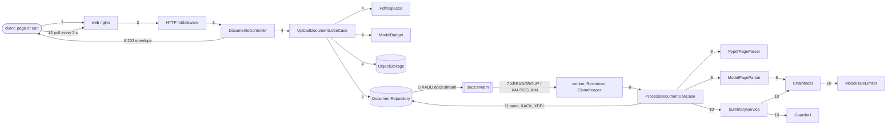
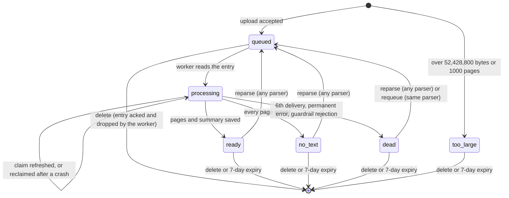

# parse-pdf

Upload PDFs, pick a parser, and read each file page by page with a short summary on top. A FastAPI
API stores the PDF and queues it on Redis Streams; workers parse it with PyPDF, Gemini 3.1 Flash
Lite or GPT-5 Mini, then write one summary per file with Gemini 3.1 Flash Lite. A React page
shows the feed on a phone, a tablet or a laptop.

## Quick start

You need Docker with Compose v2. Nothing else runs on the host.

```bash
cp .env.example .env
python3 -c "import secrets; print('SESSION_SECRET=' + secrets.token_urlsafe(48))" >> .env
docker compose up --build
```

Open <http://localhost:8080>. The API is under <http://localhost:8080/api/v1>.

`SESSION_SECRET` is the only required value. With `OPENROUTER_API_KEY` empty, PyPDF still parses
every file and the summary ends with `provider_not_configured`. Put a key in `.env` to use Gemini
3.1 Flash Lite, GPT-5 Mini and the summaries. `.env.example` lists every variable with its default.

Compose starts five services: `redis` (AOF on), `storage` (SeaweedFS, S3 API), `api` (two
uvicorn processes), `worker` (scale it with `--scale worker=3`) and `web` (nginx with the built
page, proxying `/api`). Only `web` is published to the host, on `WEB_PORT` (default 8080).

## Demo with curl

Each command prints the JSON body and then the HTTP status. The cookie jar keeps the anonymous
session. `scripts/proofs/curl-walkthrough.sh` runs this block line by line and checks every status.

<!-- walkthrough:start -->
```bash
BASE=http://localhost:8080/api/v1
curl -s -c jar.txt -b jar.txt -X POST $BASE/sessions -w '\n%{http_code}\n'
# 201
curl -s -b jar.txt -F parser=pypdf -F files=@samples/w3c-dummy.pdf -F files=@samples/constitution-of-the-united-states.pdf $BASE/documents -w '\n%{http_code}\n'
# 202
ID=$(curl -s -b jar.txt "$BASE/documents?state=all&limit=1" | jq -r '.data[0].id')
until curl -s -b jar.txt $BASE/documents/$ID | jq -e '.data.status == "ready"' >/dev/null; do sleep 1; done
curl -s -b jar.txt $BASE/documents/$ID -w '\n%{http_code}\n'
# 200
curl -s -b jar.txt "$BASE/documents/$ID/pages?offset=0&limit=50" -w '\n%{http_code}\n'
# 200
curl -s -b jar.txt "$BASE/documents?state=parsed" -w '\n%{http_code}\n'
# 200
curl -s -b jar.txt $BASE/budget -w '\n%{http_code}\n'
# 200
curl -s -b jar.txt -F parser=pypdf -F files=@samples/w3c-dummy-locked.pdf $BASE/documents -w '\n%{http_code}\n'
# 422
curl -s -b jar.txt -F parser=pypdf -F password=parse-pdf-demo -F files=@samples/w3c-dummy-locked.pdf $BASE/documents -w '\n%{http_code}\n'
# 202
curl -s -b jar.txt -X POST -H 'Content-Type: application/json' -d '{"parser":"pypdf"}' $BASE/documents/$ID/reparse -w '\n%{http_code}\n'
# 202
curl -s -b jar.txt -X POST -H 'Content-Type: application/json' -d '{"parser":"pypdf"}' $BASE/documents/$ID/reparse -w '\n%{http_code}\n'
# 409
until curl -s -b jar.txt $BASE/documents/$ID | jq -e '.data.status == "ready"' >/dev/null; do sleep 1; done
curl -s -b jar.txt -X DELETE $BASE/documents/$ID -w '\n%{http_code}\n'
# 200
curl -s -b jar.txt $BASE/documents/$ID -w '\n%{http_code}\n'
# 404
curl -s $BASE/documents -w '\n%{http_code}\n'
# 401
```
<!-- walkthrough:end -->

What the statuses mean: `202` the upload was stored and queued; the locked sample alone answers
`422 all_files_rejected` with `password_required` until the password is sent; the second reparse
answers `409 document_busy` because the first one is still queued or processing; after the
delete the document is gone (`404`); without a session every document route answers `401`.

## Postman collection

`docs/postman/parse-pdf.postman_collection.json` holds all 11 routes. Import it, send "Open a
session" first (Postman keeps the cookie), then "Upload PDFs" saves the new document's id for the
other requests. `baseUrl` defaults to `http://localhost:8080`.

## Sample PDFs

`samples/SOURCES.md` lists each file's source, license and hash.

| File | Pages | What it shows |
| --- | --- | --- |
| `w3c-dummy.pdf` | 1 | a text PDF; the fastest round trip |
| `constitution-of-the-united-states.pdf` | 85 | a long text PDF (over 10 pages), public domain |
| `constitution-scanned-p1-3.pdf` | 3 | a scanned PDF with no text layer: PyPDF ends `no_text`, Gemini 3.1 Flash Lite and GPT-5 Mini read it |
| `w3c-dummy-locked.pdf` | 1 | an encrypted PDF; password **`parse-pdf-demo`** |

The last two are generated locally by `scripts/samples/make_samples.py` (no download).

## Architecture

The request path, with the numbered steps of the plan:



1. The page (or curl) sends a multipart upload to nginx, which proxies `/api` to the API.
2. Pure ASGI middlewares add the request id, the security headers, CORS for the page origin only,
   and the `{data, error, meta}` envelope on errors.
3. The controller checks the session and the Redis rate limits.
4. Each file is checked (empty, PDF signature, 50 MiB), inspected in a killable child process
   (page count, encryption, 10 s deadline), charged to the daily model budget when a model parses
   it, and stored in the bucket.
5. The document record goes to Redis, and one stream entry (`document_id`, `object_key`,
   `run_id`) goes to `docs:stream`, in one Lua script.
6. The API answers `202` with every stored document and every refused file.
7. Workers read with `XREADGROUP`; a reclaimer takes over entries idle for 60 s with
   `XAUTOCLAIM`; a claim keeper refreshes live claims every 20 s so a long job is never stolen.
8. The use case starts the run with a `run_id` compare-and-set, so a stale or duplicate entry
   makes no parser or model call.
9. PyPDF parses in a child process killed at 300 s; the model parsers send 10-page chunks to
   OpenRouter and checkpoint each chunk.
10. Llama Guard 4 checks the text in 20,000-character pieces, Gemini 3.1 Flash Lite writes the
    summary, and Llama Guard checks the summary. Every call passes the shared rate limiter (30 per
    minute for all workers) and the retry policy, with a hard 60 s deadline per attempt.
11. Pages, summary and the final status are saved first; only then is the entry acknowledged and
    deleted. A dead job is copied to `docs:dead`.
12. The page polls the active documents every 2 s while any is queued or processing.

A document's states:



Code layout. `backend/app/documents/` holds the feature (`domain`, `use_cases`, `services`,
`controllers`); capability folders (`parsers/`, `models/`, `repositories/`, `queue/`, `storage/`,
`rate_limit/`, `security/`) keep each interface beside its implementations. Wiring happens only in
`app/container.py` (API) and `app/worker_container.py` (worker). `import-linter` contracts keep the
domain free of every other package and keep use cases off the adapters. No module under `app/` is
over 200 lines (a test enforces it). The page lives in `frontend/src/pages/UploadPage/` with one
folder per component, and reusable parts in `frontend/src/shared/`.

## API reference

Every JSON body is the envelope:

```json
{ "data": {}, "error": null, "meta": { "request_id": "..." } }
```

On an error, `data` is `null` and `error` is `{"code": "snake_case", "message": "...",
"details": {}}`. Pagination goes in `meta` (`next_cursor`, `total`, `counts`). Every response
carries `X-Request-ID`. Another session's document answers `404 document_not_found`, never `403`.

| Route | In | Out | Status |
| --- | --- | --- | --- |
| `POST /api/v1/sessions` | cookie `pp_session` if present | `{session_id, expires_at, token}` + `Set-Cookie` | `201` new, `200` existing, `429 rate_limited` |
| `POST /api/v1/documents` | multipart `files` (1-20), `parser`, optional `password` | `{documents, rejected}` | `202`, `422 invalid_parser` / `no_files` / `too_many_files` / `all_files_rejected`, `413`, `429 rate_limited` / `too_many_uploads_in_progress`, `401` |
| `GET /api/v1/documents` | `state` (`parsed` / `failed` / `active` / `all`), `cursor`, `limit` (1-50) | `[Document]`, `meta.next_cursor`, `meta.counts` | `200`, `422 invalid_limit` / `invalid_cursor` / `invalid_state`, `401` |
| `GET /api/v1/documents/{id}` | | `Document` (`summary` only when `ready`) | `200`, `404`, `401` |
| `GET /api/v1/documents/{id}/pages` | `offset`, `limit` (1-100, default 50) | `[{number, content, format}]`, `meta.total` | `200`, `409 not_ready`, `404`, `422`, `401` |
| `POST /api/v1/documents/{id}/reparse` | `{parser}` | `Document` (`queued`) | `202`, `409 document_busy` / `not_reparsable`, `422`, `429 model_budget_exhausted`, `404`, `401` |
| `POST /api/v1/documents/{id}/requeue` | | `Document` (`queued`) | `202`, `409 document_busy` / `not_dead`, `429 model_budget_exhausted`, `404`, `401` |
| `DELETE /api/v1/documents/{id}` | | `{id, deleted: true}` | `200`, `409 document_busy`, `404`, `401` |
| `GET /api/v1/budget` | | `{used, limit, resets_at}` | `200`, `401` |
| `GET /api/v1/health/live` | | `{status: "ok"}` | `200` |
| `GET /api/v1/health/ready` | | `{status, checks: {redis, storage, openrouter}}` | `200`, `503 not_ready` |

`Document` is `{id, filename, parser, status, error_code, hint, page_count, size_bytes,
created_at, updated_at, summary}`. Parsers: `pypdf` (plain text), `gemini-3.1-flash-lite`
(markdown), `gpt-5-mini` (OCR, returned as markdown).

## Decisions

The full table, with each decision's rationale and the words that settled it, is in
`.specs/STATE.md` in the repository (left out of the zip with the rest of the agent tooling).

| ID | Decision |
| --- | --- |
| AD-001 | PDF bytes in S3-compatible storage (SeaweedFS in Compose); records in Redis; stream entries carry only ids |
| AD-002 | An entry is acknowledged only after a final status is saved; a redelivered finished run makes no call |
| AD-003 | Every model call goes through OpenRouter with one key; the summary is always Gemini 3.1 Flash Lite |
| AD-004 | Pages and summary are visible only when `ready` |
| AD-005 | One unacknowledged entry per document (Lua `run_id` compare-and-set); reparse and requeue refused while busy |
| AD-006 | CORS allows only the page origin, never `*` |
| AD-007 | Security headers on every response |
| AD-008 | Limits in Redis: 10 uploads per minute and 2 in flight per session, 20 sessions per minute per IP, 30 OpenRouter calls per minute shared |
| AD-009 | Llama Guard 4 checks the summary input and output |
| AD-010 | No accounts: an anonymous signed session (HttpOnly cookie or Bearer) scopes every read and write |
| AD-011 | Feature folder plus capability folders, interface beside implementations, enforced by import-linter |
| AD-012 | 7-day retention on every key and object |
| AD-013 | 3,000 model pages per UTC day; the key holds $5 |
| AD-014 | Locked PDFs: the password decrypts the file in the request and is never stored or logged |
| AD-015 | `/api/v1`, the `{data, error, meta}` envelope, snake_case error codes, 404 for other sessions' ids |
| AD-016 | Redis with AOF every second, `noeviction`, and no `MAXLEN` trimming |
| AD-017 | One responsibility per file, no `app/` module over 200 lines, docstrings on public code |
| AD-018 | Frontend folders: page, then components, each with its own constants, types, utils and hooks |
| AD-019 | No LangChain: a typed `httpx` client behind `ChatModel` |
| AD-020 | Instagram-style feed with stories row, purple primary, light and dark themes, two fonts, outline icons, no shadows |
| AD-021 | (superseded by AD-022) |
| AD-022 | Feed chips Parsed / Failed / All filter on the server; the stories row always shows active documents |
| AD-023 | The build decides clear choices itself, records them here, and pushes `main` after each slice |
| AD-024 | Playwright e2e at 375, 768 and 1280 px, light and dark, against Compose plus a local OpenRouter stub |
| AD-025 | Two loose labels on one design frame are notes, not UI |
| AD-026 | PDF inspection and PyPDF parsing run in a one-shot killable child process per call |
| AD-027 | Llama Guard reads 20,000-character pieces; an unreadable verdict is transient, never a rejection |
| AD-028 | A hard 60 s deadline on every OpenRouter attempt; capped output tokens |
| AD-029 | One sorted set per feed group per session, moved by the same Lua scripts that change the status |
| AD-030 | The OpenRouter call limit is configurable; only the e2e stack raises it |
| AD-031 | `fonttools` added so PyPDF reads CFF fonts |
| AD-032 | The e2e stack allows 1,000 sessions per minute from its one IP; the default stays 20 |
| AD-033 | The five backend slices landed in one commit because they share one worker pipeline |

## Departures from the brief

- **One OpenRouter key instead of a Google AI Studio key.** Gemini 3.1 Flash Lite, GPT-5 Mini and
  Llama Guard all go through OpenRouter (AD-003). One key, one rate limiter, one bill.
- **The summary is always Gemini 3.1 Flash Lite.** The brief says so for the summary; the parser
  select only picks how pages are read.
- **An anonymous session instead of no access control.** The brief says nothing about who reads
  whose documents; an anonymous signed session gives each browser its own feed without a login
  screen or published demo credentials (AD-010).
- **SeaweedFS instead of MinIO.** MinIO's community image was archived and removed in 2026 (AD-001).
- **Locked PDFs are accepted with a password** rather than refused (AD-014).

## Gaps found in the brief

- The model id is written `" gemini-3.1-flash-lite ”`, with a stray space and mismatched quotes.
  The API trims and normalizes it to `google/gemini-3.1-flash-lite`.
- One place lists two parse methods, another three. All three are offered.
- "Accepts any PDF" leaves out encrypted, scanned, corrupt and huge files. Each has its own
  outcome: a password field, `no_text` with a hint, `unreadable_pdf`, `too_large`.
- The free tier answers 429. Calls retry with backoff, and a shared limiter keeps all workers under
  30 calls per minute.
- No word on retention, limits or spend. Retention is 7 days, the limits are in "Limits and
  budget", and a daily budget protects the key.
- "50MB" could mean decimal or binary; it is 52,428,800 bytes, as file pickers show it.

## Limits and budget

The shared OpenRouter key holds **$5** of credit. A daily budget of **3,000 model pages** per UTC
day guards it: each page parsed by Gemini 3.1 Flash Lite or GPT-5 Mini counts 1, and each summary
counts 1. PyPDF parsing never counts and is never refused.

- When the budget is spent, a model-parser upload is refused per file, and a model-parser
  reparse or retry with `429` (a rerun sends every page again), with
  `model_budget_exhausted` ("Today's model pages are used up. Use PyPDF, or try again after 00:00
  UTC."). The right rail shows how many pages are left.
- When the key runs out of credit, OpenRouter answers 402 and the document ends `dead` with
  `provider_out_of_credits`. The card says "The shared model key is out of credit. Try PyPDF, or
  come back later." and offers Retry, Reparse with another parser and Delete forever.
- Rate limits: 10 upload requests per minute and 2 in flight per session; 20 new sessions per
  minute per IP (the address nginx sees: it overwrites any `X-Forwarded-For` the client sends); 30 OpenRouter calls per minute for all workers together. A `429` carries
  `Retry-After`, and the page counts it down.
- Files: up to 20 per upload, 50 MiB and 1,000 pages each.
- Everything is deleted after 7 days.

## How I worked

1. **Harness first.** Before any feature code: agent edit hooks that lint each edit (ESLint with
   SonarJS for the page, ruff for the API), git hooks that run lint and `mypy --strict` on commit,
   a coverage gate at 85% line and branch, and vendored skills with pinned hashes. A phase switch
   (`discover`, `plan`, `implement`) keeps lint quiet while designing.
2. **Reading the brief.** The brief went into a local, gitignored folder and was read for what it
   asks, in what order, and what it leaves out.
3. **Planning with `tlc-spec-lean`.** Three public versions of the same task were read for their
   gaps; a gap hunt over the brief turned up the traps above; every product question went to me
   before the plan was approved: 81 EARS criteria in 7 slices, with the one-way decisions.
4. **Designing the page with `frontend-blueprint`.** A live canvas with 11 frames (phone, tablet,
   desktop, light and dark, every state), which I commented on until it looked right. The frames
   bind the build, and the e2e screenshots are compared with them.
5. **Implementing slice by slice.** Each slice was built, proven by its checks (tests, load runs, a
   real worker killed mid-job, a Redis restart, the browser), committed and pushed.
6. **A fresh-subagent review.** An independent verifier and a screens reviewer, with no part in the
   build, judged every check and every screen against the plan; one fix pass followed.
7. **`/review-before-push`.** The full diff went through the review lanes (React, Python, security,
   accessibility, clean code, performance) and a judge that keeps only verified findings.

## Testing and evidence

| What | Command |
| --- | --- |
| Backend lint | `ruff check backend && ruff format --check backend && (cd backend && mypy && lint-imports)` |
| Backend tests and coverage (85% line and branch) | `scripts/coverage-gate.sh` |
| Frontend lint and types | `npm --prefix frontend run lint && npm --prefix frontend run typecheck` |
| Frontend unit tests | `npm --prefix frontend run test` |
| End-to-end (Compose plus the OpenRouter stub) | `npm --prefix frontend run e2e` |
| Load: 5,000 reads at 200 concurrent, 50 concurrent uploads | `scripts/proofs/concurrency.sh` |
| Redis restart mid-run | `scripts/proofs/redis-restart.sh` |
| Clean checkout comes up healthy | `scripts/compose-check.sh` |
| Delivery zip | `scripts/package.sh` |

The backend tests run against a real Redis and a real SeaweedFS (`compose.test.yaml`); model
calls go to fakes, respx or a local OpenRouter stub, never the real key. The e2e suite drives
Chromium at 375, 768 and 1280 px in light and dark with no retries. The records of each proof
(command output, screenshots, the e2e report, the network log of the page, one live smoke test
whose outcome only is written down) are kept in `evidence/` in the repository.

## What I would do next

- Server-sent events instead of 2 s polling, once there are many open pages.
- A per-session model page budget on top of the global one.
- Streaming uploads to the bucket instead of reading each file into memory (50 MiB each, 20 per
  request, 2 requests per session).
- Prompt-injection detection: Llama Guard catches unsafe content, not instructions hidden in a PDF;
  today delimiters and the system message are the only defense.
- An admin view of `docs:dead` with a bulk retry.

## Time spent

Planning, design and the harness on 2026-11-19; the build on 2026-11-19 and 2026-11-20, mostly
run by the agent unattended between my reviews.
